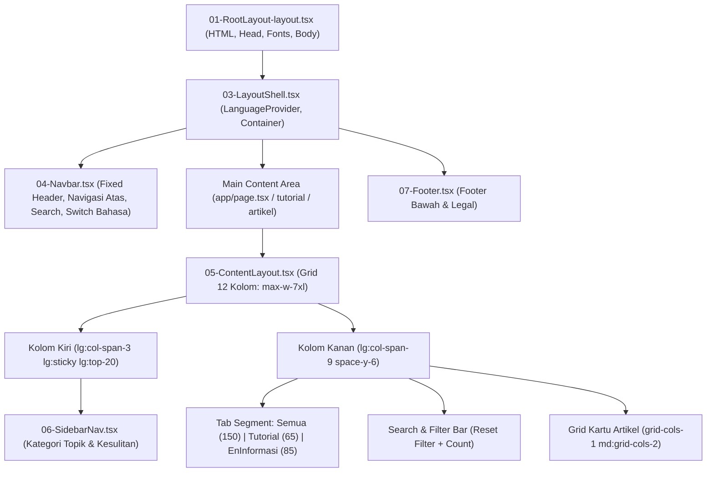

# 📐 Dokumentasi & Direktori Audit Layout EnInformasi Hub

Folder ini (`audit-layout/`) mengumpulkan seluruh file dan komponen yang mengatur tata letak (**layout**), hierarki visual, navigasi, grid responsif, serta pengaturan *sticky* website dalam **satu folder terpadu**.

---

## 📁 Daftar File dalam Folder Ini

| No | Nama File di Folder Ini | Lokasi File Asli Proyek | Fungsi & Tanggung Jawab Layout |
|:---|:---|:---|:---|
| **01** | [`01-RootLayout-layout.tsx`](file:///C:/Users/edvan/.gemini/antigravity/scratch/netkode-hub/audit-layout/01-RootLayout-layout.tsx) | `app/layout.tsx` | Root layout Next.js: pembungkus tag `<html>`, `<head>`, Google Fonts Inter & Geist Mono, serta `<body>`. |
| **02** | [`02-globals.css`](file:///C:/Users/edvan/.gemini/antigravity/scratch/netkode-hub/audit-layout/02-globals.css) | `app/globals.css` | Variabel CSS warna tema dark/light, styling scrollbar tipis modern (6px), dan utility border. |
| **03** | [`03-LayoutShell.tsx`](file:///C:/Users/edvan/.gemini/antigravity/scratch/netkode-hub/audit-layout/03-LayoutShell.tsx) | `components/LayoutShell.tsx` | Shell induk: menampung `<Navbar>`, tag `<main className="flex-1">`, `<Footer>`, dan modal `<CommandSearch>`. |
| **04** | [`04-Navbar.tsx`](file:///C:/Users/edvan/.gemini/antigravity/scratch/netkode-hub/audit-layout/04-Navbar.tsx) | `components/Navbar.tsx` | Header atas: logo brand, link tools & tentang kami, search trigger (`Cmd+K`), switch bahasa (ID/EN), tema dark/light, dan drawer mobile. |
| **05** | [`05-ContentLayout.tsx`](file:///C:/Users/edvan/.gemini/antigravity/scratch/netkode-hub/audit-layout/05-ContentLayout.tsx) | `components/ContentLayout.tsx` | Komponen layout terpadu untuk grid 12-kolom, sidebar sticky kiri (`lg:sticky lg:top-20`), serta tab segment `Semua \| Tutorial \| EnInformasi`. |
| **06** | [`06-SidebarNav.tsx`](file:///C:/Users/edvan/.gemini/antigravity/scratch/netkode-hub/audit-layout/06-SidebarNav.tsx) | `components/SidebarNav.tsx` | Sidebar kiri: list 9 kategori topik artikel, filter tingkat kesulitan, banner Tools Hub, dan collapsible view di mobile. |
| **07** | [`07-Footer.tsx`](file:///C:/Users/edvan/.gemini/antigravity/scratch/netkode-hub/audit-layout/07-Footer.tsx) | `components/Footer.tsx` | Footer website: grid navigasi bawah, hak cipta, dan link kepatuhan hukum/privasi. |
| **08** | [`08-ArticleDetailView.tsx`](file:///C:/Users/edvan/.gemini/antigravity/scratch/netkode-hub/audit-layout/08-ArticleDetailView.tsx) | `components/ArticleDetailView.tsx` | Layout halaman baca: header artikel, badan tulisan, Table of Contents sticky kanan (`sticky top-24`), dan collapsible TOC mobile. |
| **09** | [`09-HomePage-page.tsx`](file:///C:/Users/edvan/.gemini/antigravity/scratch/netkode-hub/audit-layout/09-HomePage-page.tsx) | `app/page.tsx` | Halaman beranda: Hero bento header, tab segment filter, search bar, dan grid 150 artikel. |
| **10** | [`10-TutorialPage-page.tsx`](file:///C:/Users/edvan/.gemini/antigravity/scratch/netkode-hub/audit-layout/10-TutorialPage-page.tsx) | `app/tutorial/page.tsx` | Halaman indeks katalog 65 Tutorial Praktis. |
| **11** | [`11-ArtikelPage-page.tsx`](file:///C:/Users/edvan/.gemini/antigravity/scratch/netkode-hub/audit-layout/11-ArtikelPage-page.tsx) | `app/artikel/page.tsx` | Halaman indeks katalog 85 EnInformasi & Tren Mendalam. |

---

## 🏛️ Diagram Arsitektur Layout

---

## 🔍 Titik Kunci Audit Layout (Checklist)

### 1. Perilaku Sticky Sidebar Kiri (Desktop)
* **Kelas Kunci**: `lg:sticky lg:top-20 lg:max-h-[calc(100vh-6rem)] lg:overflow-y-auto pr-1 pb-6`
* **Lokasi Pengaturan**: Diatur di [`05-ContentLayout.tsx`](file:///C:/Users/edvan/.gemini/antigravity/scratch/netkode-hub/audit-layout/05-ContentLayout.tsx) dan [`09-HomePage-page.tsx`](file:///C:/Users/edvan/.gemini/antigravity/scratch/netkode-hub/audit-layout/09-HomePage-page.tsx).
* **Fungsi**: Menjaga sidebar tetap melayang di sebelah kiri saat pengguna scroll ke bawah menelusuri ratusan artikel, dengan batas scroll internal agar menu tidak terpotong di layar laptop kecil.

### 2. Responsivitas Mobile (< 1024px)
* **Kelas Kunci**: `lg:hidden` pada elemen mobile, dan `hidden lg:block` pada sidebar desktop.
* **Komponen**: [`06-SidebarNav.tsx`](file:///C:/Users/edvan/.gemini/antigravity/scratch/netkode-hub/audit-layout/06-SidebarNav.tsx).
* **Fungsi**: Di layar ponsel, filter otomatis menjadi satu baris accordion yang bisa dibuka/tutup (`
`) berukuran 40px, sehingga tidak mendorong kartu artikel ke bawah.

### 3. Lebar & Padding Kontainer Utama
* **Kelas Kunci**: `max-w-7xl mx-auto px-4 sm:px-6 lg:px-8 py-8 sm:py-12`
* **Fungsi**: Membatasi lebar konten maksimal 1280px agar nyaman dibaca di monitor UltraWide/4K dan memiliki margin sisi proporsional di tablet maupun smartphone.

### 4. Navigasi Tab Segment Bawah
* **Komponen**: [`05-ContentLayout.tsx`](file:///C:/Users/edvan/.gemini/antigravity/scratch/netkode-hub/audit-layout/05-ContentLayout.tsx).
* **Fungsi**: Memilih antara **Semua Konten (150)**, **Tutorial Praktis (65)**, dan **EnInformasi & Tren (85)**. Tombol atas di navbar telah dibersihkan agar pengguna fokus menggunakan tab bar ini.
